<div align="center">

# CarotOS

**Siber güvenlik eğitimi için hazırlanmış Linux dağıtımı**

Debian 13 "trixie" tabanlı · XFCE · Türkçe ve İngilizce

</div>

---

## CarotOS nedir?

CarotOS, siber güvenliğe yeni başlayanlar için sıfırdan hazırlanmış bir Linux
dağıtımıdır. Amacı, güvenlik araçlarını öğrenmenin önündeki engelleri
kaldırmaktır: komut ezberlemeden kullanılabilen bir arayüz, sistemi tanıtan
bir karşılama sihirbazı ve Türkçe bir masaüstü.

Mevcut güvenlik dağıtımları uzmanlar için tasarlanmıştır — yüzlerce araç,
az rehberlik. CarotOS bunun tersini yapar: **on seçilmiş araç, her biri iyi
anlatılmış.**

> Kali Linux profesyonelin 600+ araç içeren deposuysa, CarotOS öğrencinin
> öğrenmeye başladığı yerdir.

## Öne çıkanlar

- **On iki özgün uygulama** — Python ve GTK3 ile sıfırdan yazıldı
- **Türkçe arayüz** (İngilizce seçeneğiyle), kurulumdan masaüstüne kadar
- **On güvenlik aracı**, rehberli bir panelden kullanılabilir
- **BIOS ve UEFI** desteği, imzalı önyükleyici (Secure Boot)
- Wi-Fi, ses ve grafik firmware'leri dahil — gerçek dizüstülerde çalışır
- Boşta yaklaşık **600 MB** bellek kullanımı

## Ekran görüntüleri

<div align="center">

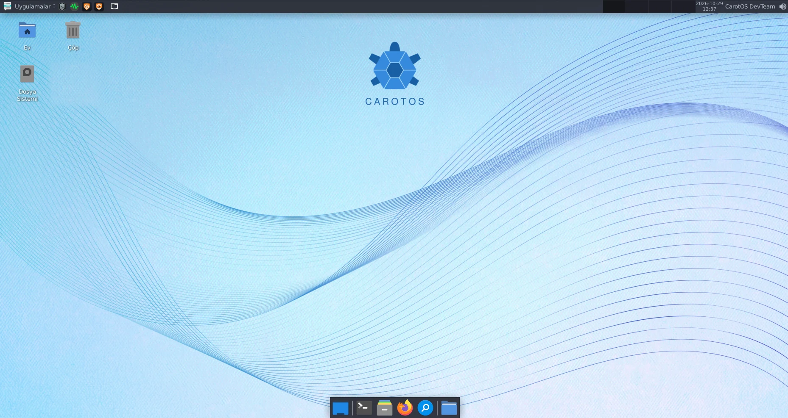

*CarotOS masaüstü — XFCE 4 ile iki panelli masaüstü düzeni ve CarotOS duvar kâğıdı.*

<br><br>

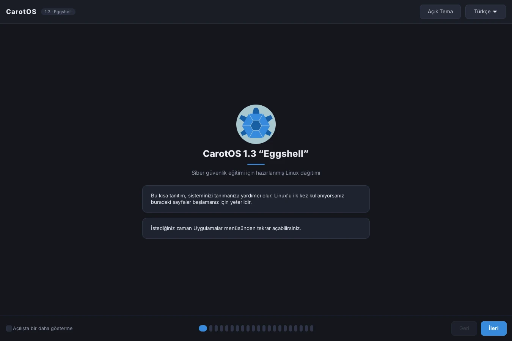

*CarotOS Karşılama Sihirbazı — İlk oturumda açılan, Linux'u ilk kez kullananlar için kısa tanıtım.*

<br><br>

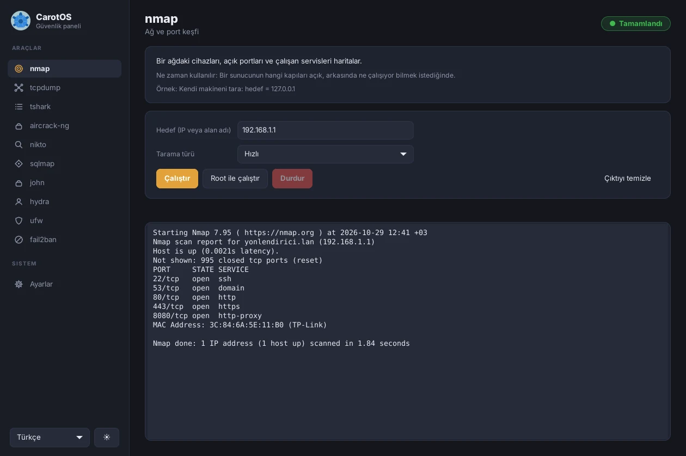

*CarotOS Güvenlik Paneli — Güvenlik araçlarını komut yazmadan kullanabilirsiniz.*

<br><br>

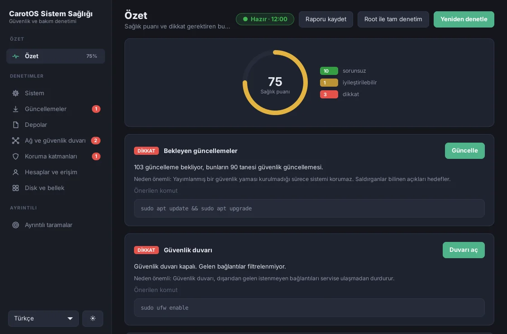

*CarotOS Sistem Sağlığı — Sistem durumu 23 denetimle kontrol edilir ve bir sağlık puanı olarak gösterilir.*

<br><br>

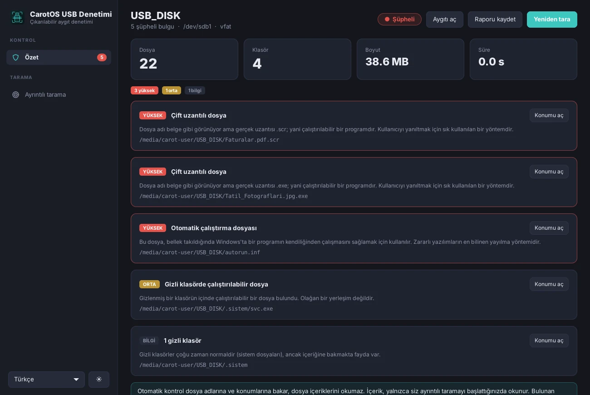

*CarotOS USB Denetimi — Bulgular önem derecesine göre sıralanır. Her bulgunun gerekçesi ve dosya yolu görünür.*

<br><br>

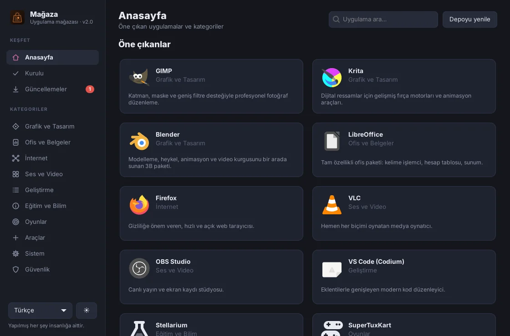

*CarotOS Mağaza — On kategorideki 153 uygulama tek tıkla kurulur ve kaldırılır.*

<br><br>

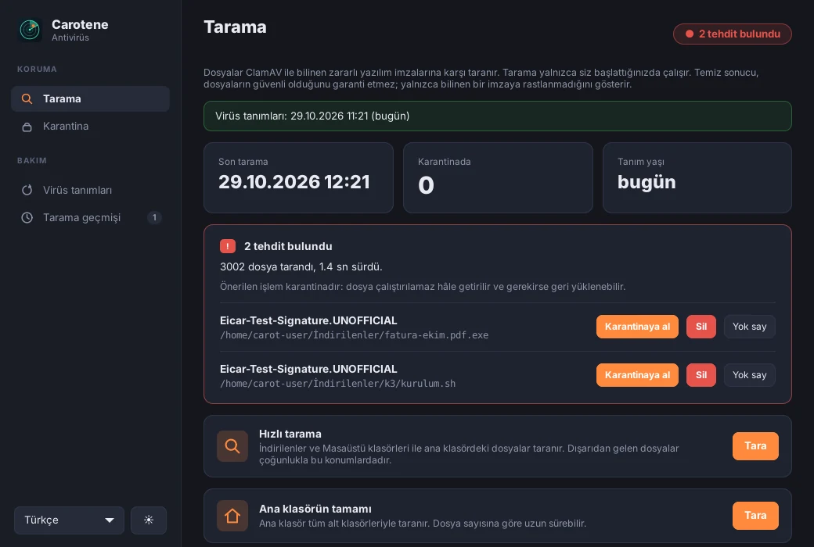

*Carotene — ClamAV ile hızlı, ana klasör ve özel klasör taraması. Bulunan dosyalar karantinaya alınabilir.*

<br><br>

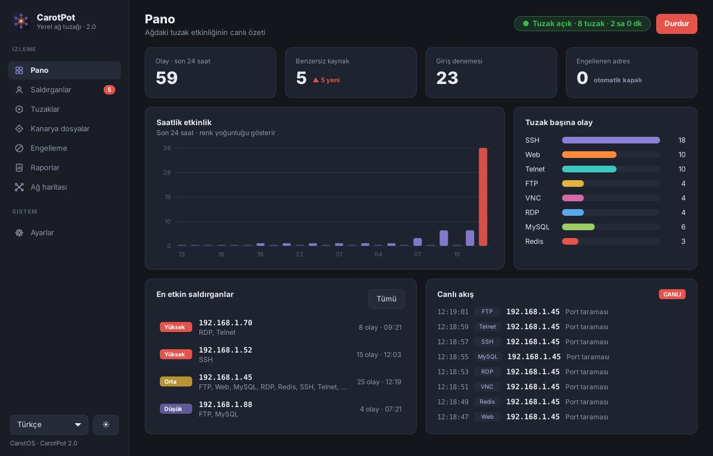

*CarotPot — Tuzak sisteminin panosu: saatlik etkinlik, tuzak başına olaylar ve en etkin saldırganlar.*

<br><br>

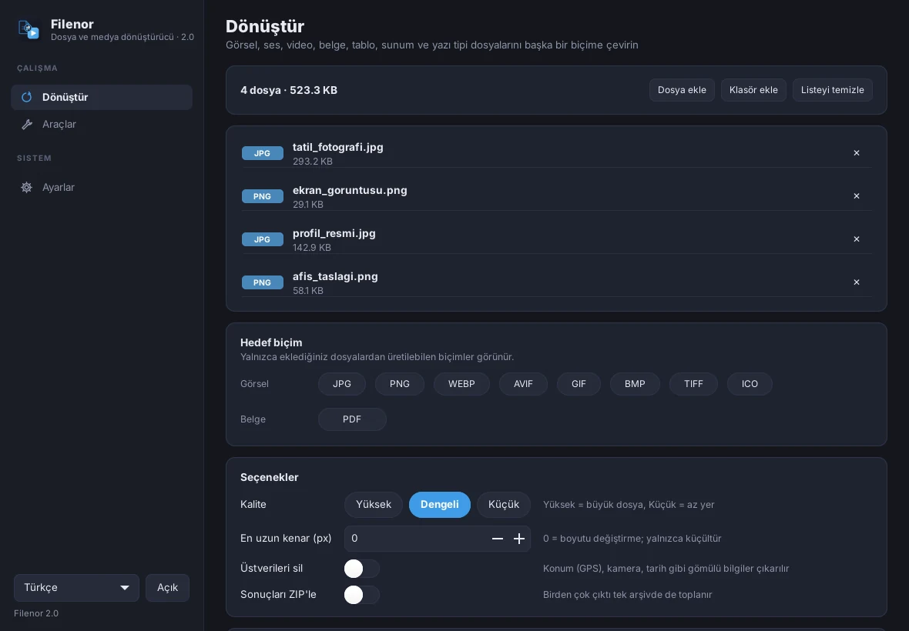

*Filenor — Eklenen dosyalar için hedef biçim seçilir ve dönüştürme ayarları yapılır.*

<br><br>

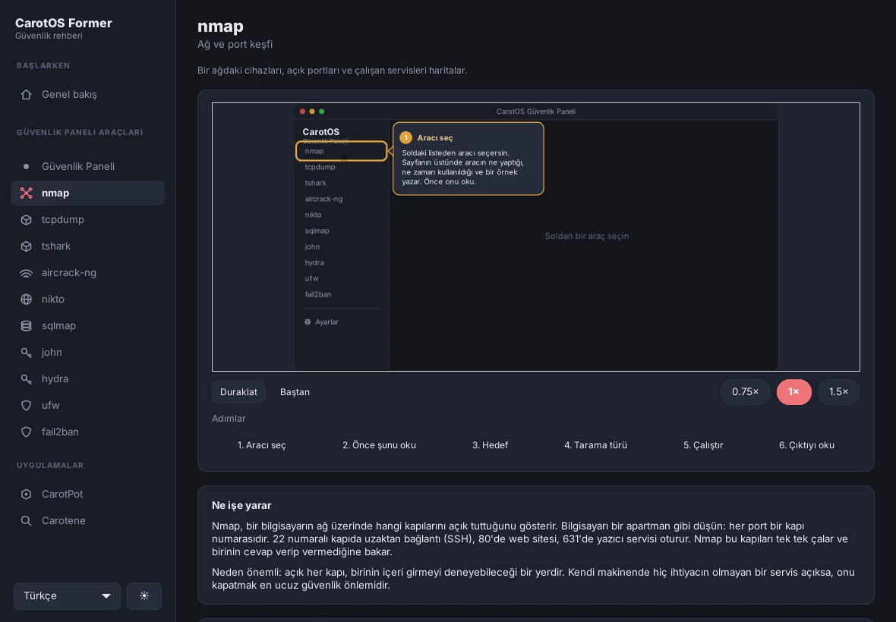

*CarotOS Former — Güvenlik araçlarını animasyonlarla ve adım adım anlatan rehber.*

<br><br>

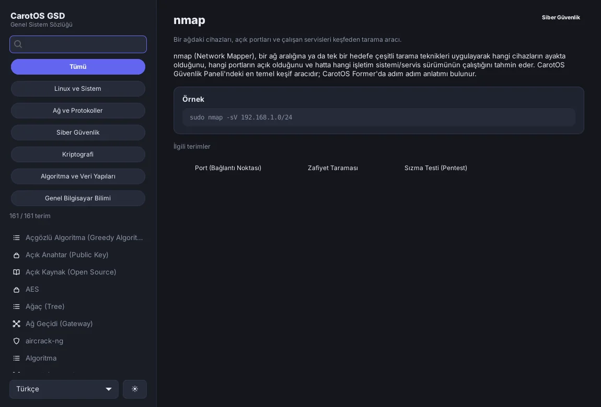

*CarotOS GSD — 161 terimlik, aranabilir, Türkçe ve İngilizce sözlük.*

<br><br>


*CarotOS Poligon — solda öğrenci, sağda öğretmen uygulaması*

</div>

## Uygulamalar

### CarotOS Güvenlik Paneli
nmap, tcpdump ve hydra gibi on güvenlik aracını komut yazmadan kullanabileceğiniz grafik arayüz. Her aracın ne işe yaradığı ekranda anlatılır, sonuçlar canlı olarak izlenir.

### CarotOS Karşılama Sihirbazı
CarotOS'u ilk açtığınızda karşınıza gelen tanıtım rehberi. Linux'un temel kavramlarını, masaüstünü ve CarotOS ile gelen uygulamaları 21 sayfada Türkçe ve İngilizce anlatır. Tema, dil ve masaüstü arka planını da buradan seçebilirsiniz.

### CarotOS Sistem Sağlığı
Bilgisayarınızın genel durumunu kontrol eden araç. Sistem, güncellemeler, ağ ve güvenlik duvarı, koruma katmanları, hesaplar ve disk gibi alanlarda 23 denetim yapar, sonucu bir sağlık puanı olarak gösterir. Sorunların çoğu tek tıkla düzeltilebilir, ayrıntılı tarama yapılabilir ve sonuçlar rapor olarak kaydedilir.

### CarotOS USB Denetimi
USB belleklerde zararlı yazılım belirtilerini arayan araç. Oturum açıldığında arka planda başlar, bir bellek takıldığında autorun.inf dosyalarını, çift uzantılı dosyaları ve klasör gibi görünen kısayolları kontrol eder. Bu kontrol dosyaların içini okumaz. İsterseniz ClamAV ile ayrıntılı bir tarama da başlatabilirsiniz. Bulunan dosyalara dokunulmaz, yalnızca raporlanır.

### CarotOS Poligon
Öğrencilerin sızma testini güvenli bir ortamda öğrendiği uygulama. Görevler hydra, nmap, john, sqlmap ve tshark ile çözülür, ufw ve fail2ban ile savunma da denenir. Tüm çalışma kendi bilgisayarınızda kalır. Kaynak kodu ayrı bir depoda tutulur: [CarotOS-Poligon](https://github.com/MiracLight/CarotOS-Poligon).

### CarotOS Poligon Öğretmen
Öğretmenlerin sınıfı yönettiği uygulama. Tek tıkla sınıf odası açar, öğrencilerin ilerlemesini izler, görev yönlendirir ve istenen öğrenciye ipucu gönderir.

### CarotOS Mağaza
Debian depolarındaki 153 uygulamayı on kategoride listeleyen yazılım mağazası. Uygulamaları tek tıkla kurup kaldırabilirsiniz. Açık ve koyu tema ile Türkçe ve İngilizce arayüz seçeneği vardır.

### Carotene
ClamAV tabanlı antivirüs uygulaması. Hızlı tarama, ana klasör taraması ve seçtiğiniz klasörün taranması mümkündür. Bulunan dosyalar karantinaya alınır, virüs tanımları uygulamadan güncellenir ve tarama geçmişi saklanır. Arka planda çalışan bir hizmet kurmaz, yalnızca siz başlattığınızda tarar.

### CarotPot
Yerel ağınızdaki şüpheli hareketleri yakalayan tuzak sistemi. SSH, Telnet, FTP ve MySQL gibi sahte hizmetler açar, bunlara bağlanan cihazları kaydeder ve sizi uyarır. Gerçek bir giriş yapılamaz. Tuzak dosyalar açıldığında ya da değiştirildiğinde de uyarır. Sistem açılışında kendiliğinden başlamaz.

### Filenor
Görsel, ses, video, belge, tablo, sunum ve yazı tipi dosyalarını tek arayüzden dönüştüren uygulama. PDF dosyalarını birleştirebilir, bölebilir, döndürebilir, küçültebilir ve kilitleyebilir, taranmış belgelerde metin tanıma (OCR) yapabilirsiniz. Var olan bir dosyanın üzerine hiçbir zaman yazmaz. Komut satırı sürümü de vardır.

### CarotOS Former
Güvenlik araçlarını animasyonlarla öğreten rehber uygulama. Güvenlik Paneli'ndeki araçların ve CarotPot ile Carotene'in her biri için konu anlatımı, oynatılabilir bir animasyon ve “kendin dene” bölümü bulunur. Türkçe ve İngilizce çalışır.

### CarotOS GSD
Genel Sistem Sözlüğü. Linux, ağ, siber güvenlik, kriptografi ve bilgisayar bilimi alanlarında 161 terim içerir. Terimleri arayabilir, örnek komutları görebilir ve ilgili terimlere geçebilirsiniz. Türkçe ve İngilizce kullanılabilir.

## Güvenlik araçları

| Araç | Ne yapar |
|------|----------|
| nmap | Ağ ve port keşfi |
| tcpdump | Ağ paketi yakalama |
| tshark | Trafik çözümleme (terminal) |
| aircrack-ng | Kablosuz ağ güvenlik testi |
| nikto | Web sunucu zafiyet taraması |
| sqlmap | SQL injection testi |
| john | Parola gücü testi |
| hydra | Oturum açma kaba kuvvet testi |
| ufw | Güvenlik duvarı |
| fail2ban | Kaba kuvvet koruması |

> **Yasal uyarı:** Bu araçlar yalnızca kendi sistemlerinizde veya açık izin
> aldığınız sistemlerde kullanılmalıdır. İzinsiz tarama ve erişim denemesi
> Türkiye'de ve pek çok ülkede suçtur.

## Kurulum

1. ISO dosyasını indirin ve sağlamasını doğrulayın:
   ```
   sha256sum -c carotos-1.3-amd64.iso.sha256
   ```
2. USB belleğe yazın (Linux'ta):
   ```
   sudo dd if=carotos-1.3-amd64.iso of=/dev/sdX bs=4M status=progress oflag=sync
   ```
   Windows'ta [Rufus](https://rufus.ie) veya
   [balenaEtcher](https://etcher.balena.io) kullanabilirsiniz.
3. Bilgisayarı USB'den başlatın.

**Önce canlı modda deneyin.** Kurulum yapmadan sistemi çalıştırabilir,
donanımınızla uyumlu olduğunu görebilirsiniz.

> **Uyarı:** Kurulum, seçtiğiniz diskteki verileri siler. Kurulumdan önce
> yedek alın.

## Kullanıcılar ve yönetici yetkisi

Root hesabı kilitlidir; yönetici işlemleri `sudo` üzerinden yapılır ve
günlüğe kaydedilir.

Kurulumu yapan ilk kullanıcı yönetici yetkisine sahiptir. Sonradan eklenen
kullanıcılar standart kullanıcıdır — çok kullanıcılı bir eğitim ortamında
kimin yönetici olacağına kurulumu yapan kişi karar verir.

Bir kullanıcıya yönetici yetkisi vermek için:

```
sudo usermod -aG sudo KULLANICIADI
```

Değişikliğin geçerli olması için kullanıcının oturumu kapatıp açması gerekir.

## Sanal makinede çalıştırma

VirtualBox kullanıyorsanız, kopyala-yapıştır ve tam ekran desteği için
Guest Additions kurmanız gerekir:

```
sudo apt update
sudo apt install -y build-essential dkms linux-headers-$(uname -r)
sudo mount -t iso9660 /dev/sr0 /media/cdrom
cp /media/cdrom/VBoxLinuxAdditions.run /tmp/
chmod +x /tmp/VBoxLinuxAdditions.run
sudo /tmp/VBoxLinuxAdditions.run
sudo reboot
```

## Kendiniz derlemek

CarotOS, Debian'ın `live-build` aracıyla üretilir. Derleme adımları,
karşılaşılan sorunlar ve çözümleri [BUILD.md](BUILD.md) dosyasındadır.

Kısaca:

```
git clone https://github.com/MiracLight/CarotOS.git
cd CarotOS
sudo lb clean --purge
lb config --distribution trixie --architectures amd64 --debian-installer live \
  --archive-areas "main contrib non-free non-free-firmware" \
  --image-name "carotos-1.3" --uefi-secure-boot enable --firmware-chroot true
sudo lb build 2>&1 | tee build.log
```

Derleme için en az 4 GB bellek ve 10 GB boş disk alanı gerekir.

## Yol haritası

- **CarotDeck (v2.0)** — ARM64 tabanlı taşınabilir cyberdeck sürümü. Daha
  hafif bir arayüz (i3wm) ve düşük bellek kullanımı hedefleniyor.
- Sistem Sağlığı'na gizlilik sekmesi (IP, VPN/Tor durumu, DNS sızıntısı)
- Rehberli öğrenme modülleri

## İletişim

- **E-posta:** carotosproject@gmail.com
- **Hata bildirimi ve öneriler:**
  [Issues](https://github.com/MiracLight/CarotOS/issues)

Hata bildirirken sürüm numarasını, kullandığınız donanımı ve sorunu yeniden
üretme adımlarını yazmanız çözümü hızlandırır.

## Lisans

CarotOS'un kendi bileşenleri (uygulamalar, yapılandırma dosyaları,
belgeler) [GNU GPL v3](LICENSE) altında dağıtılır.

CarotOS bir Debian türevidir. İçerdiği paketler kendi lisansları altındadır;
bunların büyük bölümü GPL, LGPL, BSD ve MIT lisanslıdır. Debian'ın özgür
olmayan (`non-free`, `non-free-firmware`) bileşenleri donanım desteği için
dahil edilmiştir ve kendi lisans koşullarına tabidir.

---

<div align="center">

**CarotOS 1.3 "Eggshell"**

</div>
