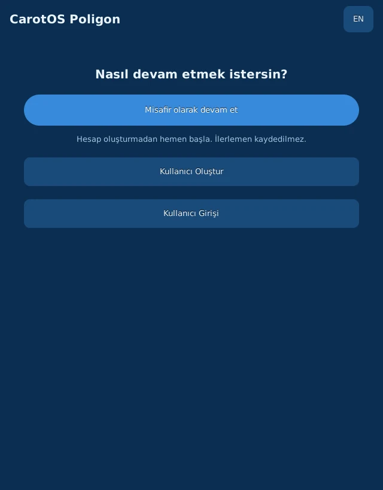
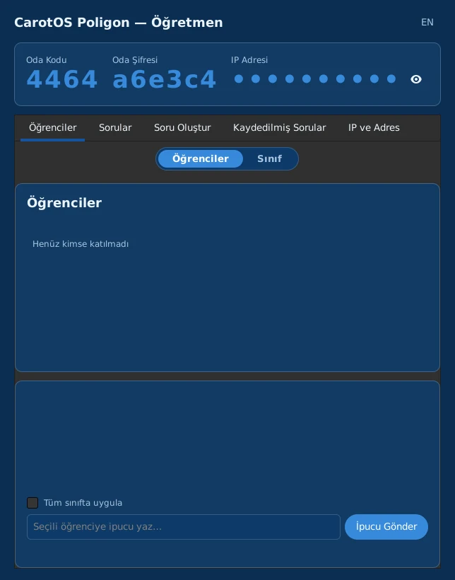

# CarotOS Poligon

CarotOS Poligon, sızma testi araçlarının denetimli bir ortamda öğretilmesi için
hazırlanmış bir öğrenci/öğretmen uygulama çiftidir.
[CarotOS](https://github.com/MiracLight/CarotOS) dağıtımının bir parçası
olarak geliştirilmiştir ve dağıtımın ISO görüntüsüne dahildir.

<div align="center">



*Solda öğrenci, sağda öğretmen uygulaması*

</div>

## Genel Bakış

Öğretmen uygulaması bir sınıf odası açar ve bir oda kodu ile şifre üretir.
Öğrenciler bu bilgilerle kendi bilgisayarlarından, aynı ağdaki öğretmenin
makinesine bağlanarak odaya katılır ya da öğretmenden bağımsız olarak
bireysel modda pratik yapabilir. Her görev, öğrencinin kendi makinesinde
yalnızca loopback (127.0.0.0/8) adreslerinde çalışan sahte bir hedef
üzerinde çözülür; hiçbir görev ağ üzerinden gerçek bir sisteme erişim
gerektirmez.

## Desteklenen Araçlar

| Araç | Kullanım Amacı |
|---|---|
| hydra | Kimlik doğrulama testi |
| nmap | Ağ ve port taraması |
| john | Parola gücü analizi |
| sqlmap | SQL enjeksiyon testi |
| tshark | Ağ trafiği çözümleme |
| ufw | Güvenlik duvarı yapılandırması (savunma görevi) |
| fail2ban | Saldırı engelleme (savunma görevi) |
| grep, awk | Günlük dosyası analizi |
| curl | Web sitesi keşfi |
| file, base64, tr | Dosya türü, kodlama ve klasik şifreler |
| CarotPot | Tuzak (honeypot) kayıtlarını okuma |

## Görevler

Uygulamada 21 görev vardır:

**Ağ ve keşif**

- Açık Port Keşfi
- Servis Sürümü Tespiti
- Ağ Trafiği Yakalama
- Gizli Dizin Keşfi

**Parola ve kimlik doğrulama**

- Parola Deneme Saldırısı
- Parola Özeti Kırma
- Hash Türü Tanıma
- SQL Enjeksiyonu

**Savunma**

- Güvenlik Duvarı ile Port Kapatma
- Otomatik Engelleme Servisi

**Günlük analizi**

- SSH Kaba Kuvvet Kaynağı
- Ele Geçirilen Hesap Tespiti
- Web Taraması Tespiti
- Taramayla Ulaşılan Yol
- Tuzak Kaydında Kullanıcı Adı Analizi
- Çok Hizmetli Tarama Tespiti

**Kodlama ve dosya analizi**

- Çok Katmanlı Kodlama Çözme
- Sezar Şifresi
- Dosya Türü Doğrulama

**CarotPot (tuzak sistemi)**

- Honeypot Tetikleme
- Honeypot Raporu Okuma

Görevler her açılışta rastgele içerik üretir (günlük dosyaları, kodlanmış
mesajlar, sahte siteler, bayraklar) ve doğru cevabı kendisi hesaplar. Bir görev
türü için birden çok soru tanımlıdır. Öğretmen yeni bir soru atadığında
bilgisayar bunlardan birini seçer ve numarası tüm sınıfa duyurulur; böylece
herkes aynı soruyu çözer, verisi ise her öğrencinin kendi makinesinde ayrı
üretilir. Öğretmen uygulamasındaki görev listesinde her görevin amacını,
kazanımını ve gerçek çalışmada nerede karşılaşıldığını anlatan bir bilgi
düğmesi bulunur.

## Gereksinimler

- Python 3.11 veya üzeri
- PyGObject (GTK 3)
- Yukarıdaki araçların sistemde kurulu olması (CarotOS ISO'sunda hazır gelir)

## Kullanım

```bash
# Öğretmen
python3 ogretmen_uygulama.py

# Öğrenci
python3 ogrenci_uygulama.py
```

Öğretmen uygulaması açılışta bir oda kodu ve şifre üretir; bu bilgiler
öğrencilerle paylaşılır. Öğrenci uygulaması açılışta bireysel pratik veya
sınıfa katılma seçeneği sunar.

## Öğrenci Hesapları

Öğrenci uygulaması misafir olarak devam etme, kullanıcı oluşturma ve
kullanıcı girişi seçeneklerini sunar. Kullanıcı bilgileri her öğrencinin
kendi makinesinde, kendi dosyasında saklanır:

```
~/.local/share/carotos-poligon/kullanicilar/<id>.json
```

Kayıt kullanıcı adını (en fazla 20 karakter) ve şifreyi içerir. Şifre,
öğrencinin okul numarasıdır (en fazla 6 hane). Şifre bilinçli olarak düz
metin saklanır ve uygulama içinden değiştirilemez; gerekirse ilgili `.json`
dosyası elle düzenlenir. Okul numarası gizli bir sır değildir; bu, sınıf
içi kullanım senaryosu için kabul edilmiş bir tercihtir.

## Soru Oluştur (Öğretmen)

Öğretmen, Soru Oluştur ekranında bir araç seçip parametrelerini kendisi
belirleyebilir. Her alan için hazır öneriler sunulur (örneğin nmap için gizli
port aralığı ve gürültü portu sayısı, john için parola hane sayısı).
Öğretmen soruyu kaydedebilir; kaydedilen sorular öğretmenin makinesinde
saklanır:

```
~/.local/share/carotos-poligon/sorular/<id>.json
```

Kaydedilmiş bir soru yeniden gönderildiğinde, makinenin cevabı yine aynı
parametrelere göre üretilir.

## Mimari

- `ogretmen_sunucu.py` — öğretmen tarafında çalışan, `http.server` tabanlı
  basit bir HTTP sunucusu. Sınıf ağından erişilebilmesi için `0.0.0.0` veya
  sınıfın yerel ağ (LAN) adresine bağlanabilir. Bu sunucu yalnızca oda ve skor
  koordinasyonu içindir; bir saldırı hedefi değildir.
- `ogrenci_istemci.py` — öğrenci uygulamasının sunucuyla ve yerel sahte
  servislerle iletişimini yöneten istemci katmanı.
- `servisler/` — her görev için izole, minimal sahte hedef servisleri
  (gerçek bir sistemi taklit etmez, yalnızca ilgili aracın çalışabileceği
  bir hedef sunar).
- `gorevler/*.json` — görev tanımları: senaryo metni, doğru cevabın nasıl
  üretileceği, doğrulama yöntemi.
- `gorev_dogrulayici.py` — görev dosyalarının şemaya uygunluğunu denetleyen
  bağımsız bir araç.
- `ag_guvenlik.py` — ağ güvenliğinin tek kaynağı: bir adresin loopback
  (127.0.0.0/8) aralığında olup olmadığını denetler.
- `kullanici_defteri.py` — öğrenci kullanıcı hesaplarının yerel olarak
  saklanması (arayüzden bağımsız, GTK'sız test edilebilir).
- `soru_defteri.py` ve `soru_sablonlari.py` — Soru Oluştur ekranının alan
  şemaları ve kaydedilmiş soruların saklanması.
- `gecmis_defteri.py` — bireysel modda ilerlemenin yerel olarak
  (`~/.local/share/carotos-poligon/`) saklanması.
- `varyantlar.py`, `varyant_gunluk.py`, `varyant_sifre.py` — görev türleri için
  soru varyantları ve her varyantın doğru cevabının hesaplanması.
- `uretilen_gorevler.py` — rastgele içerik üreten görevlerin üreteçleri.
- `tuzak_laboratuvari.py` — öğrencinin kendi makinesinde, sistemdeki gerçek
  CarotPot'tan ayrı çalışan bir tuzak örneği. Yalnızca loopback adresinde
  dinler, görev bitince kapatılır ve geçici dizinini siler.
- `gorev_bilgi.py` — öğretmen uygulamasındaki görev bilgi metinleri.
- `gorunum_ayari.py` — açık/koyu görünüm seçimi ve Poligon'a özgü ek stiller.
- `tema.py` — CarotOS uygulamalarının ortak grafit teması. CarotOS'ta
  `/opt/carotos/ortak/tema.py` altındadır; bu depoda uygulamanın tek başına
  çalışabilmesi için bir kopyası bulunur.

## Güvenlik Notları

- Tüm sahte hedef servisler yalnızca loopback (127.0.0.0/8) adreslerinde
  dinler. Kural `ag_guvenlik.py` içinde tek yerde tanımlıdır; servisler,
  öğrenci istemcisi ve şema doğrulayıcı bu denetimi oradan yapar.
  127.0.0.0/8 aralığındaki adresler yönlendirilmez, trafik makineyi terk
  etmez.
- Öğretmen sunucusu bu kuraldan bilinçli olarak muaftır: sınıf ağından
  erişilebilmesi gerekir. Yalnızca koordinasyon içindir ve yalnızca
  güvenilir bir sınıf ağında çalıştırılmalıdır.
- ufw/fail2ban görevleri öğrencinin kendi sudo yetkisini gerektirir;
  uygulama hiçbir zaman kendiliğinden yetki yükseltmez.
- Öğretmen paneline erişim, sistemin gerçek yönetici (sudo) parolasıyla
  doğrulanır.
- Kullanıcı şifreleri (okul numarası) düz metin saklanır; bkz. Öğrenci
  Hesapları.

## Testler

Depodaki `test_*.py` ile başlayan dosyalar, sunucu/istemci mantığını ve
GTK arayüzünü kapsayan testlerdir. Bazı testler ilgili araçların (hydra,
nmap vb.) sistemde kurulu olmasını gerektirir.

## Lisans

GNU General Public License v3.0. Ayrıntılar için `LICENSE` dosyasına
bakın.

## İlgili Depolar

- Dağıtım (ISO): https://github.com/MiracLight/CarotOS
- Web sitesi: https://carotos.org

---

# CarotOS Poligon (English)

CarotOS Poligon is a student/teacher application pair for teaching
penetration testing tools in a controlled environment. It is developed as
part of the [CarotOS](https://github.com/MiracLight/CarotOS) distribution and
ships with its ISO image.

## Overview

The teacher application opens a classroom room and generates a room code
and password. Students join the room from their own machines, connecting to
the teacher's machine on the same network, or practice independently in
individual mode. Every task is solved against a fake target that runs on the
student's own machine and listens only on loopback (127.0.0.0/8) addresses;
no task requires network access to a real system.

## Supported Tools

| Tool | Purpose |
|---|---|
| hydra | Authentication testing |
| nmap | Network and port scanning |
| john | Password strength analysis |
| sqlmap | SQL injection testing |
| tshark | Network traffic analysis |
| ufw | Firewall configuration (defense task) |
| fail2ban | Intrusion prevention (defense task) |
| grep, awk | Log file analysis |
| curl | Web site discovery |
| file, base64, tr | File types, encodings and classic ciphers |
| CarotPot | Reading honeypot logs |

## Tasks

The application has 21 tasks:

**Network and reconnaissance**

- Open Port Discovery
- Service Version Detection
- Network Traffic Capture
- Hidden Directory Discovery

**Passwords and authentication**

- Password Guessing Attack
- Password Hash Cracking
- Hash Type Identification
- SQL Injection

**Defense**

- Closing a Port with a Firewall
- Automatic Ban Service

**Log analysis**

- SSH Brute-Force Source
- Compromised Account Identification
- Web Scan Detection
- Path Reached by a Scan
- Username Analysis in Honeypot Logs
- Multi-Service Scan Detection

**Encoding and file analysis**

- Multi-Layer Decoding
- Caesar Cipher
- File Type Verification

**CarotPot (honeypot)**

- Triggering a Honeypot
- Reading a Honeypot Report

Every task generates random content each time it opens (log files, encoded
messages, fake sites, flags) and works out the correct answer itself. A task
type has several different questions. When the teacher assigns a new
question, the computer picks one of them and announces its number to the
whole class, so everyone solves the same question while each student's data
is still generated separately on their own machine. In the teacher
application, every task in the list has an info button that explains its
purpose, what it teaches and where it appears in real work.

## Requirements

- Python 3.11 or later
- PyGObject (GTK 3)
- The tools listed above installed on the system (included by default on
  the CarotOS ISO)

## Usage

```bash
# Teacher
python3 ogretmen_uygulama.py

# Student
python3 ogrenci_uygulama.py
```

The teacher application generates a room code and password on startup,
which are shared with students. The student application offers a choice
between individual practice and joining a class.

## Student Accounts

The student application offers continuing as a guest, creating a user, and
logging in as a user. User data is stored on each student's own machine, in
their own file:

```
~/.local/share/carotos-poligon/kullanicilar/<id>.json
```

A record holds the user name (at most 20 characters) and a password. The
password is the student's school number (at most 6 digits). It is stored in
plain text on purpose and cannot be changed from within the application; if
needed, the corresponding `.json` file is edited by hand. A school number is
not a secret; this is an accepted trade-off for in-class use.

## Create Question (Teacher)

On the Create Question screen, the teacher can pick a tool and set its
parameters. Ready-made suggestions are offered for each field (for example,
the hidden port range and noise port count for nmap, or the password digit
count for john). The teacher can save the question; saved questions are
stored on the teacher's machine:

```
~/.local/share/carotos-poligon/sorular/<id>.json
```

When a saved question is sent again, the machine's answer is generated from
the same parameters.

## Architecture

- `ogretmen_sunucu.py` — a minimal HTTP server, based on `http.server`,
  running on the teacher's machine. It can bind to `0.0.0.0` or to the
  classroom's local network (LAN) address so that it is reachable from the
  class network. This server is only for room and score coordination; it is
  not an attack target.
- `ogrenci_istemci.py` — the client layer handling communication between
  the student application, the server, and the local fake services.
- `servisler/` — isolated, minimal fake target services for each task
  (these do not emulate a real system; they only provide a target the
  relevant tool can operate against).
- `gorevler/*.json` — task definitions: scenario text, how the correct
  answer is generated, verification method.
- `gorev_dogrulayici.py` — a standalone tool that validates task files
  against the schema.
- `ag_guvenlik.py` — the single source of network safety: checks whether an
  address lies in the loopback range (127.0.0.0/8).
- `kullanici_defteri.py` — local storage of student user accounts
  (independent of the UI, testable without GTK).
- `soru_defteri.py` and `soru_sablonlari.py` — the field schemas of the
  Create Question screen and storage of saved questions.
- `gecmis_defteri.py` — local storage of individual-mode progress
  (`~/.local/share/carotos-poligon/`).
- `varyantlar.py`, `varyant_gunluk.py`, `varyant_sifre.py` — question variants
  for the task types and the calculation of each variant's correct answer.
- `uretilen_gorevler.py` — generators for tasks that produce random content.
- `tuzak_laboratuvari.py` — a honeypot instance that runs on the student's own
  machine, separate from the system's real CarotPot. It listens only on
  loopback, is shut down when the task ends and deletes its temporary
  directory.
- `gorev_bilgi.py` — the task info texts in the teacher application.
- `gorunum_ayari.py` — the dark/light appearance choice and Poligon-specific
  extra styles.
- `tema.py` — the shared graphite theme of CarotOS applications. In CarotOS it
  lives at `/opt/carotos/ortak/tema.py`; a copy is kept in this repository so
  the application can run on its own.

## Security Notes

- All fake target services listen only on loopback (127.0.0.0/8) addresses.
  The rule is defined in one place, `ag_guvenlik.py`; the services, the
  student client and the schema validator all check the bind address there.
  Addresses in 127.0.0.0/8 are not routable and traffic never leaves the
  machine.
- The teacher server is deliberately exempt from this rule: it has to be
  reachable from the class network. It is for coordination only and should
  be run only on a trusted classroom network.
- The ufw/fail2ban tasks require the student's own sudo privileges; the
  application never escalates privileges on its own.
- Access to the teacher panel is verified against the system's real
  administrator (sudo) password.
- User passwords (school numbers) are stored in plain text; see Student
  Accounts.

## Tests

Files beginning with `test_*.py` cover the server/client logic and the
GTK interface. Some tests require the corresponding tools (hydra, nmap,
etc.) to be installed.

## License

GNU General Public License v3.0. See `LICENSE` for details.

## Related Repositories

- Distribution (ISO): https://github.com/MiracLight/CarotOS
- Website: https://carotos.org
